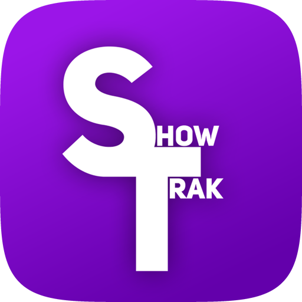
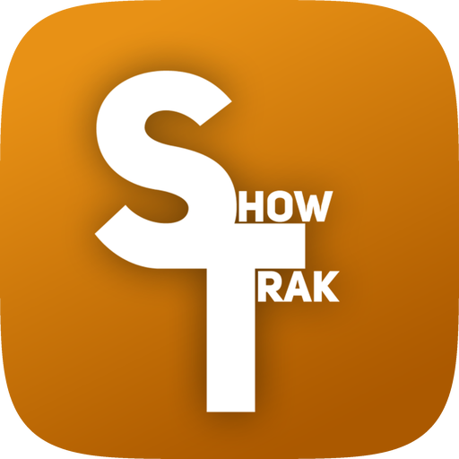

 &nbsp;  &nbsp; 

# ShowTrak

**Free tools for running live shows, venues and attractions.**

[Website](https://showtrak.co.uk) · [Downloads](https://showtrak.co.uk/software) · [Documentation](https://showtrak.co.uk/docs) · [Discord](https://discord.gg/DACmwsbSGW)

This repository holds the [ShowTrak organisation](https://github.com/ShowTrak) profile and shared GitHub settings:

- `profile/README.md`: the public organisation profile.
- `images/`: the rounded app icons and screenshots the profile uses.
- `FUNDING.yml`: the sponsor links shown on every ShowTrak repository.

Find everything else at **[showtrak.co.uk](https://showtrak.co.uk)**.
