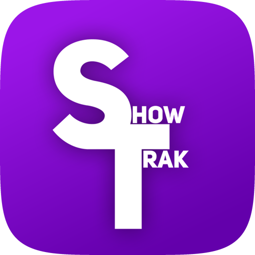

# ShowTrak

**Free tools for running live shows, venues and attractions.**

[Website](https://showtrak.co.uk) · [Downloads](https://showtrak.co.uk/software) · [Documentation](https://showtrak.co.uk/docs) · [Discord](https://discord.gg/DACmwsbSGW)

[![Windows][badge-windows]](https://showtrak.co.uk/software) [![macOS][badge-macos]](https://showtrak.co.uk/software) [![Linux][badge-linux]](https://showtrak.co.uk/software) [![Raspberry Pi][badge-raspberrypi]](https://showtrak.co.uk/software) [![iOS and iPadOS][badge-ios]](https://showtrak.co.uk/software) [![Android][badge-android]](https://showtrak.co.uk/software) [![Web browser][badge-web]](https://showtrak.co.uk/software)

ShowTrak keeps the technology behind your show running. Monitor every computer and show device
from one screen, run the show's clocks, and keep your company's show reports in one place. Used
in immersive theatre, attractions and venues across the UK.

## The apps

<table>
  <tr>
    <td align="center" width="25%"><a href="https://github.com/ShowTrak/ShowTrakServer"> <b>ShowTrak Server</b></a> Monitor and control every computer and show device from one screen.</td>
    <td align="center" width="25%"><a href="https://github.com/ShowTrak/ShowTrakClient"> <b>ShowTrak Client</b></a> The lightweight app that lets ShowTrak Server watch and control a computer.</td>
    <td align="center" width="25%"><a href="https://github.com/ShowTrak/ShowTrakTimers"> <b>ShowTrak Timers</b></a> Show timers run from the desk, a Stream Deck, QLab or any browser.</td>
    <td align="center" width="25%"><a href="https://showtrak.co.uk"> <b>ShowTrak Portal</b></a> Show reports, schedules and team collaboration for live productions.</td>
  </tr>
</table>

**Coming soon:** [ShowTrak Remote](https://github.com/ShowTrak/ShowTrakRemote) to run ShowTrak Server from
your phone, the ShowTrak Portal app for iOS and Android, and
[ShowTrak Flow](https://github.com/ShowTrak/ShowTrakFlow) for pulsed-entry shows.

## Works with your show

- **QLab**: ShowTrak Server is built into QLab 5.6.5 and later ([latest description](https://github.com/ShowTrak/ShowTrak-QLabNetworkDeviceDescription)).
- **Bitfocus Companion and Stream Deck**: the [ShowTrak Server module](https://github.com/bitfocus/companion-module-showtrak-server).
- **OSC and HTTP**: from any show control system.
- **Your own apps**: the [TypeScript SDK](https://github.com/ShowTrak/ShowTrakServer-SDK-TS) and [Android SDK](https://github.com/ShowTrak/ShowTrakClient-SDK-Android).
- **Sample scripts**: [ready-made scripts](https://github.com/ShowTrak/SampleScripts) for everyday jobs.

## Support

Questions, ideas or problems? Join the [ShowTrak Discord](https://discord.gg/DACmwsbSGW) or [contact support](https://showtrak.co.uk/support).

[badge-windows]: https://img.shields.io/badge/Windows-0078D4?style=for-the-badge&logo=data:image/svg%2bxml;base64,PHN2ZyB4bWxucz0iaHR0cDovL3d3dy53My5vcmcvMjAwMC9zdmciIHZpZXdCb3g9IjAgMCAyNCAyNCI%2BPHBhdGggZmlsbD0iI2ZmZiIgZD0iTTAgMy40NDkgOS43NSAyLjF2OS40NTFIMG0xMC45NDktOS42MDJMMjQgMHYxMS40SDEwLjk0OU0wIDEyLjZoOS43NXY5LjQ1MUwwIDIwLjY5OU0xMC45NDkgMTIuNkgyNFYyNGwtMTIuOS0xLjgwMSIvPjwvc3ZnPg%3D%3D
[badge-macos]: https://img.shields.io/badge/macOS-000000?style=for-the-badge&logo=apple&logoColor=white
[badge-linux]: https://img.shields.io/badge/Linux-FCC624?style=for-the-badge&logo=linux&logoColor=black
[badge-raspberrypi]: https://img.shields.io/badge/Raspberry%20Pi-A22846?style=for-the-badge&logo=raspberrypi&logoColor=white
[badge-ios]: https://img.shields.io/badge/iOS%20%26%20iPadOS-000000?style=for-the-badge&logo=apple&logoColor=white
[badge-android]: https://img.shields.io/badge/Android-3DDC84?style=for-the-badge&logo=android&logoColor=white
[badge-web]: https://img.shields.io/badge/Web%20Browser-5B2EB8?style=for-the-badge&logo=data:image/svg%2bxml;base64,PHN2ZyB4bWxucz0iaHR0cDovL3d3dy53My5vcmcvMjAwMC9zdmciIHZpZXdCb3g9IjAgMCAyNCAyNCIgZmlsbD0ibm9uZSIgc3Ryb2tlPSIjZmZmIiBzdHJva2Utd2lkdGg9IjIiPjxjaXJjbGUgY3g9IjEyIiBjeT0iMTIiIHI9IjEwIi8%2BPHBhdGggZD0iTTIgMTJoMjBNMTIgMmExNSAxNSAwIDAgMSAwIDIwTTEyIDJhMTUgMTUgMCAwIDAgMCAyMCIvPjwvc3ZnPg%3D%3D
